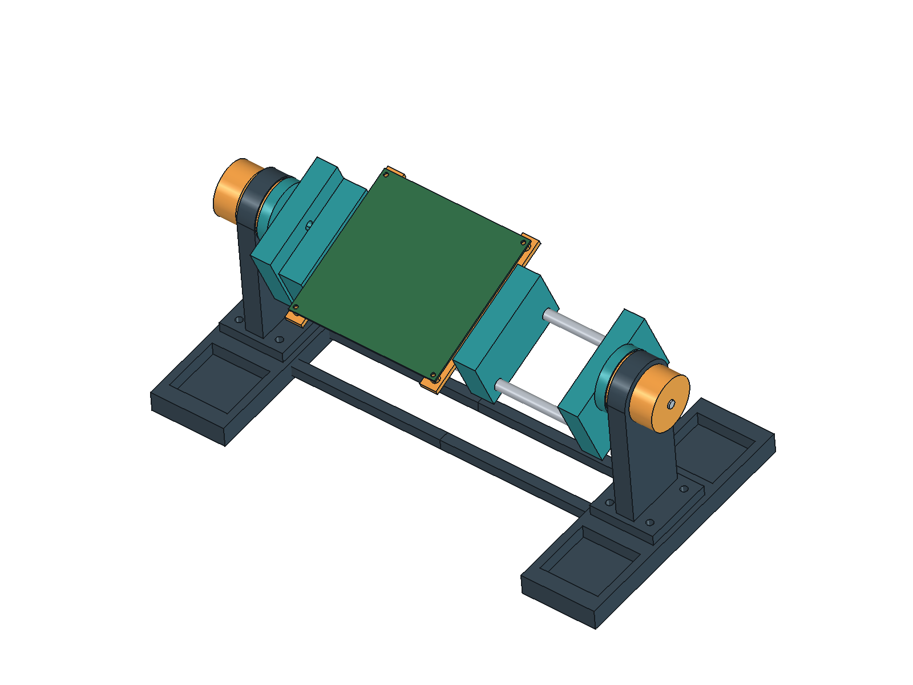

# rotating pcb vise

a freestanding holder for soldering and inspecting PCBs. the frame turns over so both sides of the board are reachable, and the jaw spacing adjusts along two metal rods

## first layout

this is the first CAD layout, not a finished printable design. it has the base, uprights, rotating frame, guide rods, adjustable jaw bodies and a mounting-hole adapter for the ESC

the ESC's right edge has pads and connector tabs where a straight grip would sit. this version uses its four existing M3 mounting holes on a 109 x 105 mm pattern. the green plate is a board envelope with those holes, not a populated PCB model. generic edge-grip inserts still need designing

## CAD

open [cad/pcb-vise-layout.FCStd](cad/pcb-vise-layout.FCStd) in FreeCAD. the Dimensions object holds the board size, rod size, rotation height and viewing angle. the model keeps its primitive and boolean features so those can be edited too

[cad/build_layout.FCMacro](cad/build_layout.FCMacro) rebuilds the layout. [exports/pcb-vise-layout.step](exports/pcb-vise-layout.step) is the assembly export for viewing in other CAD tools

## printer and materials

the printer is a Bambu P1S. PLA, Bambu TPU for AMS and PETG-CF are available. start with the [PLA rod and nut fit sample](exports/fit-tests/README.md). PETG-CF is a candidate for the structural parts, and TPU for AMS for removable feet or contact pads. the print orientation and layer strength still need checking. Bambu specifies a hardened-steel nozzle for PETG-CF

parts will fit within the P1S's 256 x 256 mm bed. the assembled holder is wider, so the base is split. this is for hand soldering and inspection; take the PCB out for reflow

## hardware

[hardware-candidates.csv](hardware-candidates.csv) records the first hardware choices and sources. two 8 x 250 mm steel rods are the starting point. fastener lengths, friction material, ballast and shipping still need choosing, so there is no finished purchase BOM yet

## next

- finish the coarse jaw lock and adapter fasteners
- design the generic edge-grip inserts
- finish the pivot bolt retention and test the friction lock
- join the base sections and retain the ballast
- check the populated ESC's underside and screw clearances
- print the fit samples before exporting the complete printed parts

## references

- [8 x 250 mm rod](https://abra-electronics.com/robotics/axles-rods/mp-rm8-250-8mm-m8-250mm-linear-shaft-rail-rod.html)
- [M6 nut dimensions](https://www.accu.co.uk/hexagon-nuts/456464-HPN-M6-C10)
- [Bambu PETG-CF printing guidance](https://us.store.bambulab.com/collections/bambu-lab-3d-printer-filament/products/petg-cf)

## checks so far

all 27 layout parts are valid solids and the STEP file imports with 27 solids. the rotating assembly clears the base at 24 sampled angles, 15 degrees apart. board widths of 30, 116 and 160 mm recompute correctly. these checks use the unpopulated board envelope and do not establish clamp strength, continuous swept clearance or fit around actual components

the PLA fit coupon is one valid solid and its STL mesh is closed. the results are in [cad/checks.json](cad/checks.json). physical fit testing is still needed
