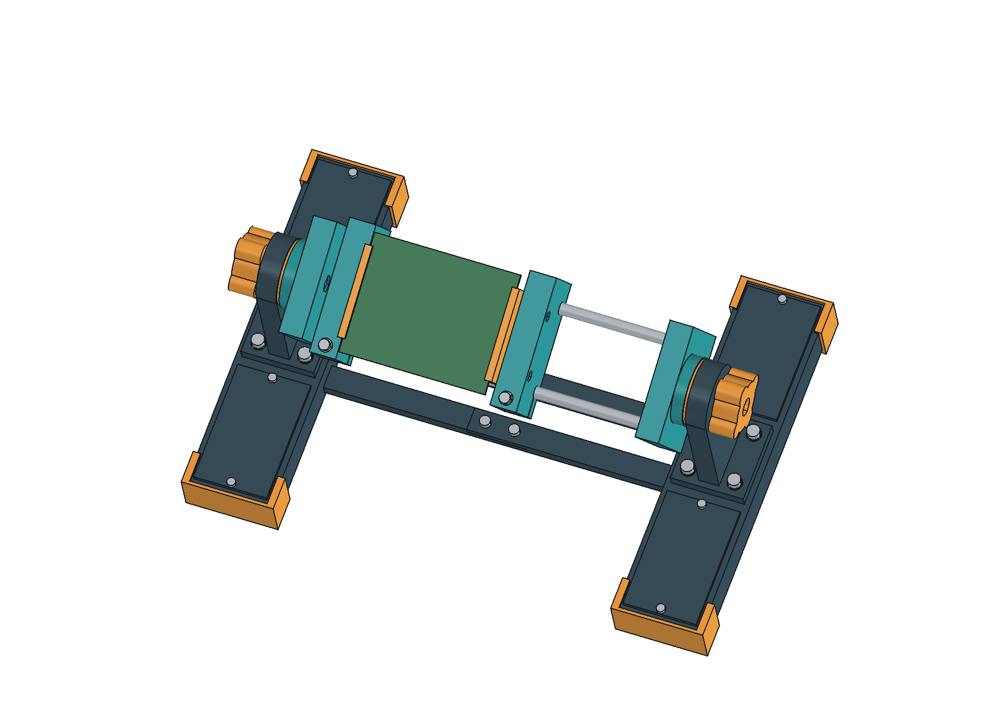
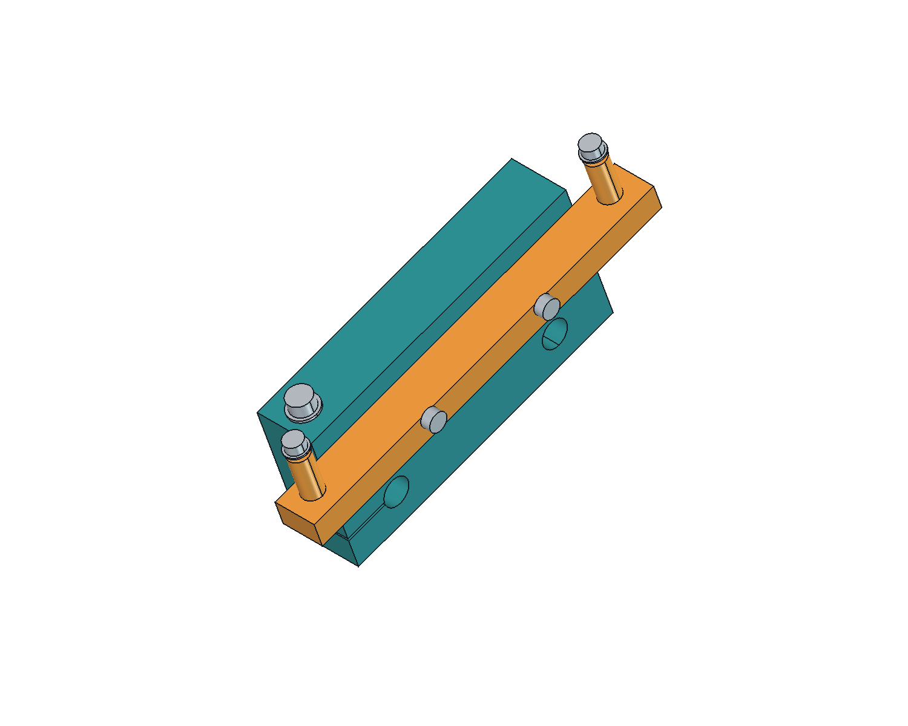

# pcb vise

[Half Life project](https://halflife.hackclub.com/projects/cmv5uxwy90kuh01n00i6f4u88)

i'm making a rotating holder for soldering and working on circuit boards. the jaws slide to fit different board sizes, and the frame flips over so you can get to the back without taking the board out

this is my CAD week project for Half Life. the design is still in progress. printing and assembly come later, during build week

## how it works

two steel rods hold the jaws. each jaw has a slit and an M4 screw that locks it onto a rod. the knobs at the ends tighten the rotating frame against the uprights to hold its angle

the grips bolt onto the jaws, so they can be replaced. there are two versions so far:

- an adapter that uses the four mounting holes on my ESC
- TPU grips with slots for the edges of other boards

the ESC adapter uses mounting holes because there are components close to the edge where a normal grip would sit. its hole spacing is 109 x 105 mm

the base has pockets for extra weight and removable lids. TPU feet slide over the ends. the base splits into smaller pieces joined with screws so it fits on my P1S

## materials

i'm planning to use PETG-CF for the rigid parts and TPU for AMS for the feet, grips and friction rings. i also have PLA for fit samples when build week starts. the rods, screws, nuts and washers will be metal

## files

- [FreeCAD model](cad/pcb-vise.FCStd)
- [STEP file](exports/pcb-vise.step)
- [STL files](exports/parts/)
- [hardware list](HARDWARE.md) and [CSV](hardware.csv)
- [assembly instructions](ASSEMBLY.md), still being worked on

## still to finish

- check the holder against the populated ESC, including room for cables and tools
- work out the ballast and check whether the base needs to be wider
- finish the tolerances and dimensioned drawings
- choose suppliers and price the full hardware list, including shipping
- go through the parts in the slicer and adjust anything awkward to print

then i can finish the design files and submit this week's work. nothing has been printed or tested yet
